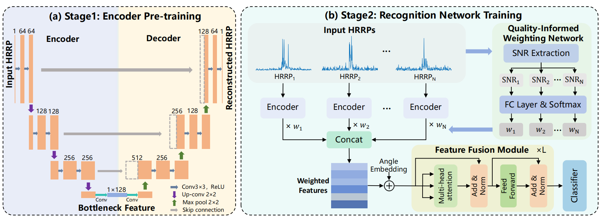
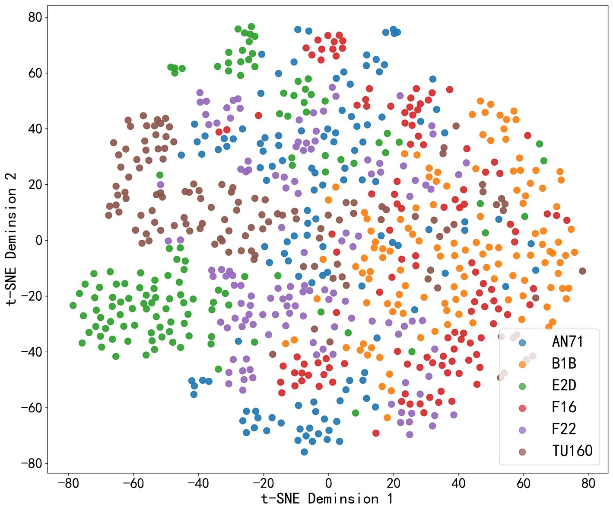
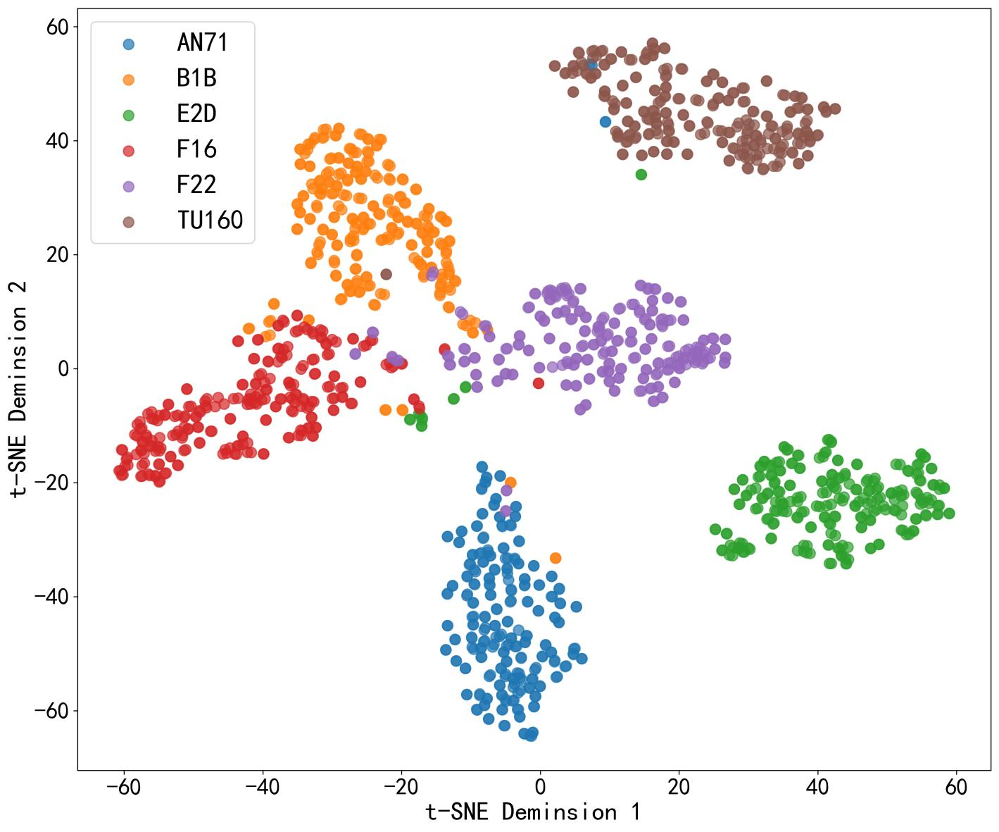

# Quality-Aware HRRP Target Recognition Network for Multistatic Radar Systems (QAMN)

Official repository for the paper **"Quality-Aware HRRP Target Recognition Network for Multistatic Radar Systems"**, accepted at the **34th European Signal Processing Conference (EUSIPCO 2026)**, Bruges, Belgium, Aug. 31 – Sep. 4, 2026.

We propose **QAMN**, a quality-aware multi-view recognition network for **radar automatic target recognition (RATR)** in **multistatic radar systems**. QAMN explicitly estimates the **SNR (quality) of each high-resolution range profile (HRRP)** view and adaptively re-weights per-view feature contributions, achieving **95.67% recognition accuracy**.

## 📄 Abstract

> Radar automatic target recognition (RATR) based on high-resolution range profile (HRRP) has attracted increasing attention for its ability to capture fine-grained structural features. However, in multistatic radar systems, heterogeneous operating conditions such as varying radar positions and nonideal factors like clutter and interference can lead to multi-view HRRPs with inconsistent imaging quality. Existing recognition methods are generally unable to perceive such quality variations, thereby resulting in degraded recognition performance. To address this, we propose a quality-aware multi-view recognition network (QAMN) that explicitly models the reliability of each HRRP for robust multi-view target recognition. QAMN is trained in two stages: a UNet-based encoder is first pre-trained to learn robust HRRP feature representations. Subsequently, the encoder is fine-tuned to extract per-view features, while a quality-informed weighting network predicts reliability weights and applies them to weight the feature contributions. The weighted features are then concatenated and fed into a feature fusion module that performs efficient cross-view feature integration and classification. Experimental results demonstrate that the proposed QAMN significantly improves recognition performance in multistatic radar systems compared with existing methods.

## 🖼️ Method Overview

**QAMN** consists of three key components:

1. **UNet-based Encoder** — pre-trained as a denoising autoencoder to extract noise-invariant HRRP representations;
2. **Quality-Informed Weighting Network** — estimates per-view SNR via an amplitude-threshold strategy and predicts reliability weights through an FC + softmax module;
3. **Transformer-based Feature Fusion Module** — integrates cross-view complementary information with angle embedding (azimuth/elevation) and multi-head self-attention for classification.

  
    
    
<em>Overall framework of QAMN: (a) two-stage training — encoder pre-training; (b) quality-aware multi-view recognition network.</em>  

## 📊 Results

Simulation setup: 6-radar multistatic system, CST electromagnetic simulation, carrier 3 GHz, bandwidth 320 MHz, pulse width 100 µs, 6 aircraft classes (AN71, B1B, E2D, F16, F22, TU160), HRRP length N = 512, SNR ∈ [15, 25] dB, 6,072 training / 1,524 testing samples.

| Method                          |  Acc. (%) | Prec. (%) |  Rec. (%) |    F1 (%) |
| ------------------------------- | --------: | --------: | --------: | --------: |
| DNN-MVF                         |     85.50 |     88.74 |     85.50 |     85.67 |
| DSNN                            |     88.45 |     88.76 |     88.45 |     88.50 |
| Manifold-Net                    |     90.29 |     90.45 |     90.29 |     90.32 |
| QAMN-v1 (w/o quality weighting) |     91.99 |     92.46 |     91.99 |     92.03 |
| QAMN-v2 (ResNet-18 encoder)     |     92.19 |     92.28 |     92.19 |     92.17 |
| **QAMN (Ours)**                 | **95.67** | **95.70** | **95.67** | **95.67** |

  
  \&nbsp;  
    
    
<em>t-SNE visualization of feature representations: raw HRRP features (left) vs. features learned by QAMN (right).</em>  

## 🔗 Links

- **Official Paper:** [eurasip.org/Proceedings/Eusipco/Eusipco2026/pdfs/0002296.pdf](https://eurasip.org/Proceedings/Eusipco/Eusipco2026/pdfs/0002296.pdf)
- **Conference:** [EUSIPCO 2026 — Bruges, Belgium](https://eusipco2026.org/)
